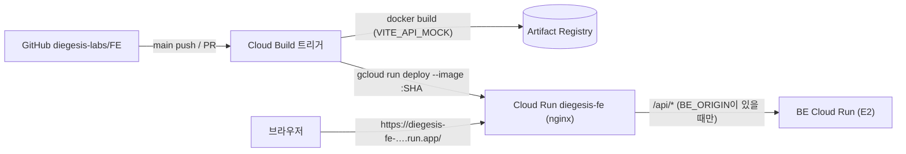

# Phase 15: GCP Cloud Run 배포로 옮기기

- 상태: 완료 (단계 6은 머지 뒤)
- 선행 phase: 없음 (10 Vercel 배포, 12 로그인 모두 `main`에 머지됨)
- 관련 이슈: [#33 GCP Cloud Run 배포로 옮기기](https://github.com/diegesis-labs/FE/issues/33)
- 브랜치: `setup/33-gcp-deploy` (`main`의 `e6b570b`에서 만듦)
- 계획 커밋: `293c3c9`
- 구현 커밋: `28e7c0e` (단계 6은 머지 뒤)
- 리뷰 문서: [15-gcp-deploy-review.md](../reviews/15-gcp-deploy-review.md) (리뷰 단계에서 작성)

## 목표

FE를 Vercel에서 GCP Cloud Run으로 옮긴다. `main`에 머지되면 Cloud Build가 컨테이너 이미지를 만들어 Cloud Run에 배포한다. 컨테이너의 nginx는 화면 파일을 내보내고, `/api`로 시작하는 요청만 BE로 넘긴다. BE 주소는 환경 변수 하나로 붙인다. BE가 배포되기 전에는 지금처럼 데모 모드(MSW 목)로 동작한다.

## 배경

- 2026-11-24 "FE, BE API/마일스톤 회의"(Confluence)에서 FE와 BE를 모두 GCP에 배포하기로 했다 (Decisions, 결정 표 3번). 음원은 Cloudflare R2에 둔다. 도메인은 Cloudflare에서 사기로 했다가 2026-11-25에 사지 않기로 바꿨다 (아래 결정).
- 같은 회의에서 정한 E2(배포 연결, 3주차 초)의 FE 짝 작업은 "FE 호스팅(GCP)에 `/api` rewrite 추가, 운영 주소에서 로그인 쿠키 확인"이다. 이 phase에서 FE를 GCP로 먼저 옮겨 두면, E2 때는 BE 주소를 넣고 로그인만 확인하면 된다.
- BE [INFRA.md](https://github.com/diegesis-labs/BE/blob/main/docs/INFRA.md) 2.1절은 같은 도메인 조건을 "FE 호스팅이 `/api` 요청을 BE로 넘겨줌"으로 맞추기로 했다. 4절은 "FE를 GCP의 어느 서비스에 올릴지"를 FE 담당이 알려 주기로 했다.
- **Firebase Hosting을 쓰지 않는 이유**: INFRA.md 2.1절은 Firebase Hosting → Cloud Run 연결을 예로 든다. 그런데 Firebase Hosting은 Cloud Run으로 요청을 넘길 때 `__session` 말고는 쿠키를 모두 뗀다. BE 로그인은 `diegesis_session`과 `diegesis_oauth_state` 두 쿠키를 쓴다 (BE API.md, ADR-025). 그래서 BE 계약을 바꾸지 않으면 로그인이 되지 않는다. 넘겨주는 요청에는 60초 시간 제한도 있어서 묶음 적재(ADR-019)에도 걸린다.
- 결정 (2026-11-25, 사용자): 호스팅은 **Cloud Run 컨테이너(nginx)**, 배포는 **Cloud Build GitHub 트리거**다. Phase 10과 같은 원칙으로 GitHub에 배포 비밀값을 두지 않는다. 비교한 다른 안은 Firebase Hosting(쿠키 제약), GCS와 HTTPS 부하 분산기(월 고정비), GitHub Actions와 Workload Identity Federation이다.
- 결정 (2026-11-25, 사용자): **도메인을 사지 않는다.** Cloud Run 기본 주소(`*.run.app`)가 HTTPS이고 Google 로그인 돌아올 주소로 등록할 수 있어서, 10명 안팎의 MVP 테스트에 충분하다. 서울 리전에는 Cloud Run 도메인 매핑이 없어서, 도메인을 붙이려면 Cloudflare 프록시나 부하 분산기가 따로 필요했다.

## 범위

### 하는 것

1. **컨테이너 이미지**
   - `Dockerfile`: 두 단계로 만든다. 1단계는 Node 24와 Corepack pnpm으로 `pnpm build`, 2단계는 nginx로 `dist/`를 내보낸다.
   - `.dockerignore`
   - 기반 이미지는 태그가 아니라 digest로 고정한다.
2. **nginx 설정** `deploy/nginx/`: SPA rewrite, 보안 헤더, 캐시 규칙, `/api` 넘겨주기를 둔다. 지금 `vercel.json`이 하는 일을 그대로 옮긴다.
3. **Cloud Build 설정** `cloudbuild.yaml`: 이미지 빌드, Artifact Registry에 올리기, Cloud Run 배포. 이미지 태그는 커밋 SHA다.
4. **GCP 리소스** (CLI로 만들고 명령을 문서에 남긴다):
   - Artifact Registry 저장소
   - Cloud Run 서비스 `diegesis-fe`
   - Cloud Build GitHub 연결과 트리거 두 개 (`main` push, PR)
   - 빌드용 서비스 계정과 최소 권한
   - 예산 알림
5. **PR 미리보기**: PR 트리거가 트래픽 없는 리비전을 `pr-<번호>` 태그로 배포해서 PR마다 주소를 준다.
6. **Vercel 정리**: GCP production 배포를 확인한 뒤에 한다.
   - `vercel.json`을 지운다.
   - Vercel Git 연결을 끊는다.
   - Vercel 프로젝트 삭제는 사용자가 정한다.
7. **문서**
   - `docs/architecture.md` 5장을 다시 쓴다: 배포 구성, BE가 생기면 할 일, 되돌리는 법.
   - README의 배포 주소
   - `.env.example` 주석
   - BE 담당에게 공유할 내용 (아래 "BE와 맞출 것")
8. **작업 절차 검사가 phase 문서 이름 변경을 따라가게** (`scripts/check-process.mjs` 검사 4): 이 phase의 번호를 13에서 15로 옮기자, 검사가 첫 코드 커밋 시점의 문서를 지금 이름으로만 찾아서 실패했다. 그 시점에 없으면 git 이름 변경 기록(`git log --follow`)의 예전 이름으로 다시 찾는다. 테스트를 더하고 `docs/guardrails.md`의 설명을 고친다.

### 하지 않는 것

- **BE 주소 연결과 운영 로그인 확인.** E2(배포 연결, 3주차 초. BE 이슈는 아직 없음)의 FE 짝 작업으로 따로 한다. 이 phase는 `BE_ORIGIN` 환경 변수가 비어 있으면 `/api`에 404를 주는 데까지만 한다.
- **직접 등록한 도메인.** 도메인을 사지 않고 Cloud Run 기본 주소를 운영 주소로 쓴다 (아래 "운영 주소").
- **CSP 헤더.** Phase 10과 같은 이유로 뒤로 미룬다.
- `ci.yml`과 ruleset 변경. Cloud Build의 커밋 상태는 필수 검사로 만들지 않는다. 필수 검사는 지금처럼 `check` 하나다.
- 화면 코드(`src/`) 변경. 데모 모드와 목 시나리오는 그대로다.
- CDN(Cloud CDN)과 부하 분산기.
- BE 레포 수정. 공유만 한다.

## 설계

### FSD 배치

해당 없음. `src/`를 바꾸지 않는다.

| 위치                          | 만들거나 바꿀 것                                                     |
| ----------------------------- | -------------------------------------------------------------------- |
| `Dockerfile`, `.dockerignore` | 새 파일. 빌드 단계와 nginx 단계                                      |
| `deploy/nginx/`               | 새 폴더. `default.conf.template`, `/api` 설정을 고르는 시작 스크립트 |
| `cloudbuild.yaml`             | 새 파일. 빌드 → 올리기 → 배포 (main: 트래픽 전환, PR: 태그만)        |
| `vercel.json`                 | 마지막 단계에서 지운다                                               |
| `eslint.config.js`            | `.vercel` 무시 항목 정리 (지울지 리뷰 때 판단, 바꾸면 사용자 확인)   |
| 문서                          | `docs/architecture.md` 5장, `README.md`, `.env.example`              |

### 구성



### 컨테이너

- **빌드 단계**: `node:24-alpine`(digest 고정)에서 `corepack enable` 후 `pnpm install --frozen-lockfile`, `pnpm build`. `pnpm-workspace.yaml`의 `minimumReleaseAge`와 `allowBuilds`가 그대로 적용된다. 빌드 인자는 `VITE_API_MOCK` 하나다. Vite가 빌드 때 이 값을 박아 넣기 때문이다.
- **실행 단계**: 공식 nginx alpine 이미지(digest 고정)에 `dist/`와 설정만 복사한다. 이 이미지의 템플릿 기능(`/etc/nginx/templates/*.template` → `envsubst`)으로 `PORT`와 `BE_ORIGIN`을 시작할 때 넣는다.
- 이미지에는 소스, `node_modules`, `.env*`를 넣지 않는다 (`.dockerignore`, 두 단계 빌드).

### nginx 규칙 (`vercel.json`에서 옮김)

| 규칙              | 내용                                                                                                                                                                                                                                                                                                                                                                     |
| ----------------- | ------------------------------------------------------------------------------------------------------------------------------------------------------------------------------------------------------------------------------------------------------------------------------------------------------------------------------------------------------------------------ |
| 듣는 포트         | `$PORT` (Cloud Run 기본 8080)                                                                                                                                                                                                                                                                                                                                            |
| SPA rewrite       | `try_files $uri /index.html`. `/api/`는 제외. 실제 파일(`/assets/…`, `/favicon.svg`, `/mockServiceWorker.js`)을 먼저 찾는다                                                                                                                                                                                                                                              |
| 보안 헤더         | `X-Content-Type-Options: nosniff`, `Referrer-Policy: strict-origin-when-cross-origin`, `X-Frame-Options: DENY`, `Permissions-Policy: camera=(), microphone=(), geolocation=()`. nginx의 `add_header`는 `location`에 하나라도 있으면 바깥 것을 물려받지 않으므로, 공통 파일을 `include`해서 모든 `location`에 같은 헤더가 붙게 한다                                       |
| 캐시              | `/assets/`: `public, max-age=31536000, immutable` (성공 응답에만). 없는 `/assets/` 파일은 `index.html`이 아니라 404. 그 밖의 경로(`index.html`, `mockServiceWorker.js`, `favicon.svg`): `no-cache`                                                                                                                                                                       |
| 압축              | gzip (text, js, css, json, svg)                                                                                                                                                                                                                                                                                                                                          |
| `/api/` (BE 없음) | `BE_ORIGIN`이 비어 있으면 404 `text/plain`. 지금 Vercel과 같다. `index.html`을 JSON 대신 받는 일이 없다                                                                                                                                                                                                                                                                  |
| `/api/` (BE 있음) | `proxy_pass $BE_ORIGIN`<br>헤더: `proxy_ssl_server_name on`, `Host`는 BE 호스트, `X-Forwarded-Proto: https`, `X-Forwarded-For`, `X-Forwarded-Host`<br>`Set-Cookie`와 `Cookie`는 건드리지 않는다<br>`client_max_body_size 32m` (Cloud Run 요청 본문 제한과 같게)<br>`proxy_read_timeout 300s` (묶음 적재)<br>`resolver`를 둬서 BE 주소를 시작할 때 한 번만 풀지 않게 한다 |
| 로그              | 접근 로그는 stdout (Cloud Logging). nginx 로그에는 쿼리 문자열을 빼고 경로만 남긴다 (`code`·`state`). Cloud Run 자체의 요청 로그에는 쿼리가 남는다 (위험과 열린 질문 7)                                                                                                                                                                                                  |

`/api` 설정은 시작 스크립트(`/docker-entrypoint.d/`)가 `BE_ORIGIN`이 있는지 보고 두 파일 중 하나를 고른다. 빈 값으로 `proxy_pass`를 만들면 nginx가 뜨지 않기 때문이다.

### Cloud Run 서비스

| 설정      | 값                                                                                         |
| --------- | ------------------------------------------------------------------------------------------ |
| 리전      | `asia-northeast3` (서울). BE와 같은 리전에 둔다                                            |
| 서비스    | `diegesis-fe`, 공개 (`allUsers`에 `run.invoker`, 아래 참고)                                |
| 크기      | CPU 1, 메모리 256Mi, 동시 요청 80                                                          |
| 인스턴스  | 최소 0(비용), 최대 2(비용 상한)                                                            |
| 환경 변수 | `BE_ORIGIN` (지금은 없음. E2에서 넣는다. 런타임 값이라 이미지를 다시 만들지 않는다)        |
| 이미지    | `asia-northeast3-docker.pkg.dev/<프로젝트>/diegesis/fe:<커밋 SHA>`. `latest`를 쓰지 않는다 |

### 운영 주소

도메인을 사지 않고, Cloud Run이 서비스마다 만들어 주는 기본 주소를 운영 주소로 쓴다.

```
https://diegesis-fe-<프로젝트 번호>.asia-northeast3.run.app
```

- HTTPS 인증서는 구글이 발급하고 갱신한다. DNS 설정이 없다.
- FE와 BE가 이 주소 하나를 함께 쓴다 (nginx가 `/api`를 BE로 넘김). 그래서 로그인 쿠키는 같은 출처에서 동작한다.
- Google OAuth의 운영 돌아올 주소는 `<이 주소>/api/auth/google/callback`이다 (E2에서 등록).
- 테스트 참가자(10명 안팎)에게는 이 링크를 직접 보낸다.
- 같은 서비스에 예전 형식의 주소(`https://diegesis-fe-<해시>-du.a.run.app`)도 생긴다. 문서와 OAuth에는 위의 주소 하나만 쓴다. 두 주소는 출처가 달라 쿠키를 나눠 쓰지 않는다.
- 주소는 배포 뒤에 `gcloud run services describe diegesis-fe --format='value(status.url)'`로 확인한다. README와 architecture.md 5장에 적는다.

### Cloud Build 트리거

| 트리거    | 조건             | 하는 일                                                                                                                                                 |
| --------- | ---------------- | ------------------------------------------------------------------------------------------------------------------------------------------------------- |
| `fe-main` | `main` push      | `VITE_API_MOCK=true`로 빌드 → 올리기 → 배포, 트래픽 100%                                                                                                |
| `fe-pr`   | `main`을 향한 PR | 같은 빌드 → 올리기 → `--no-traffic --tag pr-<번호>`로 배포. 주소: `https://pr-<번호>---diegesis-fe-….run.app`<br>외부 기여자 PR은 댓글 승인 뒤에만 돈다 |

- `VITE_API_MOCK`은 트리거의 대체 변수(`_VITE_API_MOCK`)로 둔다. E2에서 BE를 붙일 때 이 값만 바꾼다.
- 빌드는 전용 서비스 계정으로 돈다. 권한은 Artifact Registry 쓰기, Cloud Run 배포, 실행 서비스 계정의 `actAs`, 로그 쓰기만 준다. 기본 Compute 서비스 계정의 편집자 권한을 쓰지 않는다.

  | 서비스 계정 | 용도                  | 권한                                                                                                                                               |
  | ----------- | --------------------- | -------------------------------------------------------------------------------------------------------------------------------------------------- |
  | `fe-run`    | Cloud Run 실행        | 없음 (nginx는 GCP API를 부르지 않는다)                                                                                                             |
  | `fe-build`  | Cloud Build 빌드·배포 | 저장소 `diegesis`의 `artifactregistry.writer`, 프로젝트의 `run.developer`·`logging.logWriter`, `fe-run`의 `iam.serviceAccountUser`, 소스 버킷 읽기 |

- 로컬에서 `gcloud builds submit`으로 올릴 때 소스를 담는 버킷 `gs://diegesis-front-build-src`(서울, 7일 뒤 자동 삭제)를 따로 둔다. 기본 버킷(`<프로젝트>_cloudbuild`, 미국)을 쓰지 않고, `fe-build`에 이 버킷 읽기만 준다. GitHub 트리거는 버킷을 쓰지 않는다.
- 서비스 공개(`allUsers`에 `run.invoker`)는 프로젝트 소유자가 처음 한 번 `gcloud run services add-iam-policy-binding`으로 건다. 공개 설정은 서비스에 남아서 배포마다 다시 할 필요가 없다. `fe-build`의 `run.developer`로는 IAM 정책을 바꿀 수 없고, 그 권한(`run.admin`)을 빌드 계정에 주지 않는다. 그래서 `cloudbuild.yaml`에는 `--allow-unauthenticated`를 넣지 않는다.
- 빌드 로그는 Cloud Logging에만 남긴다 (`CLOUD_LOGGING_ONLY`). 전용 서비스 계정으로 빌드하려면 로그 위치를 정해야 하기 때문이다.
- Cloud Build의 docker 빌더는 기본이 예전 빌더라서 `DOCKER_BUILDKIT=1`을 켠다 (`Dockerfile`의 `COPY --chmod`).
- Artifact Registry 정리 정책: 최근 이미지 10개만 남긴다.
- 예산 알림: 결제 계정에 `diegesis-front` 프로젝트만 보는 월 1만 원 예산을 두고, 50%·90%·100%에서 메일을 받는다 (사용자 결정). 알림일 뿐 비용을 막지는 않는다.
- **사용자가 직접 할 것**:
  - GCP 프로젝트를 만들고 결제 계정을 연결한다.
  - Cloud Build GitHub 앱을 `diegesis-labs` 조직에 설치한다. 조직 소유자의 브라우저 승인이 필요하다.
  - 로컬에 `gcloud`를 설치하고 로그인한다 (`! gcloud auth login`).
  - 나머지는 `gcloud` 명령으로 하고 architecture.md 5장에 남긴다.

### 옮기는 순서 (끊김 없이)

1. GCP에 배포하고, Vercel은 그대로 둔다.
2. GCP production 주소에서 확인한다: 완료 기준의 화면과 헤더 항목.
3. README와 architecture.md의 주소를 GCP로 바꾼다.
4. 사용자가 확인한 뒤에 `vercel.json`을 지우고 Vercel Git 연결을 끊는다 (`vercel git disconnect`). 끊은 뒤 PR에 Vercel 상태가 더 생기지 않는지 본다.
5. Vercel 프로젝트(`diegesis-fe.vercel.app`)를 지울지, 한동안 마지막 배포를 남겨 둘지는 사용자가 정한다.

**되돌리는 법**: Cloud Run은 이전 리비전으로 트래픽을 옮긴다 (`gcloud run services update-traffic --to-revisions`). Vercel은 4단계 전까지는 그대로 살아 있다.

### BE와 맞출 것 (공유만, 이 phase에서 BE를 바꾸지 않음)

- FE 호스팅은 Cloud Run(nginx)이다. BE INFRA.md 3.1절의 선택지 중 무엇이든 HTTPS 주소만 있으면 붙는다. Cloud Run끼리면 같은 리전(서울)이 지연에 좋다.
- 운영의 `FRONTEND_URL`은 FE의 `run.app` 주소다. Google OAuth에 등록할 돌아올 주소는 `<FE 주소>/api/auth/google/callback`이다. BE INFRA.md 3.4절(도메인과 HTTPS)은 할 일이 없어진다.
- FE가 넘겨주는 요청의 본문 상한은 32MiB, 응답 대기는 300초다. 묶음 적재 크기와 시간이 이 안에 들어야 한다.
- 쿠키 이름과 속성은 그대로 써도 된다. 같은 출처라서 `SameSite=Lax`, `Secure`로 충분하다.

방법: E2 계약을 맞출 때 BE#9와 E2 이슈에 댓글로 남긴다. 회의록(2026-11-24)의 결정 표 3번과 Decisions에는 "도메인을 사지 않고 Cloud Run 기본 주소를 쓴다"를 2026-11-25에 적었다.

### 화면과 상태

화면 코드는 바꾸지 않는다. 데모 모드의 로딩, 빈 목록, 에러, 401, 허용 목록 밖 화면은 MSW 시나리오로 GCP 주소에서도 그대로 볼 수 있다.

### 새 의존성

- npm 패키지: 없음.
- 컨테이너 기반 이미지는 Docker Hub 공식 이미지 두 개다. 둘 다 Docker 공식 이미지 관리 주체다. `Dockerfile`에 digest로 고정했다 (2026-11-25 확인).
  - `node:24-alpine@sha256:116b800c3754…` (Node 24.22.3, 2026-11-11 빌드): 빌드 단계 전용이라 실행 이미지에는 남지 않는다.
  - `nginx:stable-alpine@sha256:8eb2b5540eae…` (nginx 1.30.8, 2026-11-23 빌드). 빌드된 지 2일이다. npm의 3일 규칙(`minimumReleaseAge`)은 이미지에 적용되지 않지만, 같은 취지로 리뷰 때 다시 확인한다.
- Cloud Build 단계 이미지는 Google 공식 빌더 두 개다. `cloudbuild.yaml`에 digest로 고정한다 (2026-11-25 확인, 둘 다 2026-11-19 빌드).
  - `gcr.io/cloud-builders/docker@sha256:2d89b48c704d…`: 이미지 빌드와 올리기
  - `gcr.io/cloud-builders/gcloud@sha256:dc291205504c…`: Cloud Run 배포
- 로컬 도구: `gcloud` CLI (Google 공식, Homebrew cask `gcloud-cli`). 레포에는 들어가지 않는다.

## 작업 단계

- [x] 1. 사용자 준비를 부탁한다: GCP 프로젝트와 결제, `gcloud` 로그인. 필요한 API를 켠다 (Cloud Run, Cloud Build, Artifact Registry, 예산 알림용 Billing Budgets). 예산 알림을 만든다.
- [x] 2. `Dockerfile`, `.dockerignore`, `deploy/nginx/`를 만든다. 로컬에서 확인한다.
  - `docker build --build-arg VITE_API_MOCK=true`로 만들고 `docker run -e PORT=8080`으로 띄운다.
  - `/`, `/books/<id>?chapter=2` 새로 고침, 없는 경로, `/api/books` 404, 헤더(`curl -I`)를 본다.
  - `BE_ORIGIN`에 로컬 BE(compose)를 넣었을 때 `/api/health`가 넘어가는지 본다. BE에 로그인 코드가 아직 없어서, BE API.md 4.2~4.3절대로만 움직이는 가짜 BE로 로그인 흐름(시작, 콜백, `/api/me`, 로그아웃)을 개발 서버와 컨테이너 양쪽에서 확인했다.
- [x] 3. Artifact Registry, 실행용과 빌드용 서비스 계정, `cloudbuild.yaml`을 만든다. 첫 배포는 로컬에서 `gcloud builds submit`으로 해서 Cloud Run 서비스를 만든다.
- [x] 4. 사용자에게 Cloud Build GitHub 앱 설치를 부탁한다. 설치되면 트리거 두 개를 만든다. 이 phase의 PR에서 `pr-<번호>` 태그 주소가 생기는지 확인한다.
- [x] 4-1. 작업 절차 검사 4가 phase 문서의 예전 이름도 찾게 고친다 (범위 8). `pnpm test:scripts`와 `pnpm check:process`로 확인한다.
- [x] 5. architecture.md 5장, README, `.env.example`을 고친다.
- [ ] 6. 머지 뒤 `fe-main` 트리거로 production이 바뀌는지 확인한다. 그다음 Vercel을 정리한다: `vercel.json` 삭제와 Git 연결 끊기는 후속 PR로 한다.
  - [x] `fe-main` 확인: 머지 커밋 `3d86352`의 빌드가 성공했고, 트래픽 100%가 `diegesis-fe-3d86352-24b201`(라벨 `commit-sha`가 머지 커밋)로 옮겨졌다. `/`, `/books` 200, 없는 `/assets/` 404, `/api/me` 404, 보안 헤더 4개.
  - [ ] 후속 PR (브랜치 `setup/33-vercel-cleanup`): Vercel 프로젝트 `diegesis`의 Git 연결을 끊고(`vercel git disconnect`), `vercel.json`을 지우고, 5장의 "Vercel (옮기는 중)"을 고친다. 그 PR에 Vercel 상태가 생기지 않는지 본다. `pr-37` 태그를 지운다. `.gitignore`, `.dockerignore`, `eslint.config.js`의 `.vercel` 항목은 Vercel 프로젝트가 남아 있어서 그대로 둔다.
- [x] 7. `pnpm format:check`, `pnpm lint`, `pnpm typecheck`, `pnpm build`, `pnpm test:scripts`, `pnpm check:process`를 통과시킨다.

## 완료 기준

- [ ] `pnpm format:check`, `pnpm lint`, `pnpm typecheck`, `pnpm build`, `pnpm test:scripts`, `pnpm check:process`가 통과한다.
- [ ] 이미지에 소스, `node_modules`, `.env*`가 없다 (`docker run --rm <이미지> ls -R /usr/share/nginx/html`, 이미지 크기 기록).
- [ ] GCP production 주소를 확인한다.
  - `/`에 책 목록(데모 모드)이 보인다.
  - `/books/<id>?chapter=2`를 직접 열거나 새로 고쳐도 리더가 뜬다.
  - 없는 경로는 앱의 404 화면이다.
- [ ] 응답 헤더를 확인한다.
  - 모든 경로(`/`, `/books/…`, `/assets/…`)에 보안 헤더 4개가 있다.
  - `/assets/*`는 `immutable` 캐시다.
  - `index.html`과 `mockServiceWorker.js`는 `no-cache`다.
- [ ] `BE_ORIGIN`이 없으면 `/api/books`가 404 `text/plain`이다.
- [ ] 로컬 컨테이너에 `BE_ORIGIN`을 주면 `/api/health`가 BE로 넘어간다. 응답의 `Set-Cookie`가 바뀌지 않고 그대로 브라우저에 온다 (로컬 BE에서 확인 가능한 만큼).
- [x] `main`에 머지되면 Cloud Build가 production을 자동으로 바꾼다. 배포된 이미지 태그가 머지 커밋 SHA와 같다.
- [ ] PR마다 `pr-<번호>` 태그 주소가 생긴다. 이 주소는 production 트래픽을 받지 않는다.
- [ ] GitHub에 배포 비밀값이 없다. `ci.yml`과 ruleset이 바뀌지 않았다. 빌드 서비스 계정에 편집자 권한이 없다.
- [ ] architecture.md 5장에 다음이 적혀 있다.
  - 배포 구성
  - GCP 리소스를 만든 명령
  - BE가 생기면 할 일: `BE_ORIGIN` 넣기, `_VITE_API_MOCK` 끄기, 서비스 워커 정리
  - 되돌리는 법
- [ ] Vercel Git 연결이 끊겼고 `vercel.json`이 없다 (6단계 후속 PR).

## 위험과 열린 질문

1. **운영 주소가 GCP 프로젝트에 묶인다**: `run.app` 주소에는 프로젝트 번호가 들어간다. 프로젝트를 옮기거나(BE INFRA.md 3.9절, 무료 크레딧) 서비스를 다시 만들면 주소가 바뀐다. 그러면 Google OAuth 돌아올 주소, BE `FRONTEND_URL`, 테스트 참가자에게 보낸 링크를 모두 고쳐야 한다. 실사용 테스트 기간(12/21~27)에는 프로젝트와 서비스를 바꾸지 않는다. 나중에 도메인이 필요해지면 다음 phase에서 연결 방법을 정한다. 서울 리전은 Cloud Run 도메인 매핑이 없어서 Cloudflare 프록시나 부하 분산기를 따져야 한다.
2. **콜드 스타트**: 최소 인스턴스 0이라 한동안 요청이 없으면 첫 화면이 늦을 수 있다. nginx는 가벼워서 보통 1초 안이지만 측정해서 리뷰에 적는다. 실사용 테스트 기간(12/21~27)에만 최소 1로 올리는 방법도 있다. 그만큼 비용이 든다.
3. **PR 태그 정리**: PR이 닫혀도 `pr-<번호>` 태그와 리비전이 남는다. 리비전은 비용이 없지만 쌓인다. 일단 수동 정리 명령을 5장에 적고, 많아지면 자동 정리를 다음 phase로 둔다.
4. **PR 미리보기의 보호**: Vercel Preview는 로그인한 팀원만 볼 수 있었다. Cloud Run 태그 주소는 공개다. 데모 데이터(저작권이 끝난 단편)만 있어서 지금은 괜찮다. BE를 붙인 뒤에도 Preview는 데모 모드로 두거나, Google 로그인과 허용 목록으로 막힌다.
5. **GCP 계정과 비용**: FE 전용 프로젝트 `diegesis-front`(번호 `872555598631`)를 사용자 계정에 만들었다 (사용자 결정). BE와는 프로젝트가 다르다. BE INFRA.md 3.9절의 무료 크레딧 기한도 따진다. 이 phase는 Cloud Run 무료 범위와 Artifact Registry 0.5GB 안에 들 것으로 본다. 월 1만 원 예산 알림으로 확인한다.
6. **Cloud Build PR 트리거 권한**: 외부 기여자 PR이 GCP에서 빌드를 돌리지 못하게 댓글 승인을 켠다. 지금은 조직 구성원만 PR을 올린다.
7. **Cloud Run 요청 로그의 쿼리**: Cloud Run이 Cloud Logging에 남기는 요청 로그에는 전체 주소가 들어가서, Google 로그인 결과의 `code`·`state`가 남는다. nginx 설정으로는 막을 수 없다. `code`는 한 번만 쓸 수 있고 짧게 유효하며 PKCE(`code_verifier`)가 없으면 바꿀 수 없어서 위험은 낮다고 본다. 로그를 볼 수 있는 사람은 GCP 프로젝트 구성원뿐이다.

## 변경 기록

- 2026-11-25: 작성. 호스팅(Cloud Run nginx)과 배포 방식(Cloud Build 트리거)은 사용자 결정
- 2026-11-25: 도메인을 사지 않고 Cloud Run 기본 주소를 운영 주소로 쓰기로 함 (사용자 결정). 도메인 연결 열린 질문을 지우고 "운영 주소" 절을 더함. Confluence 회의록에도 반영
- 2026-11-25: 승인. 이슈 #33 생성, 브랜치 `setup/33-gcp-deploy`
- 2026-11-25: 계획 변경 (단계 2 구현 중 확인). (1) 없는 `/assets/` 파일은 `index.html` 대신 404를 주고, 장기 캐시는 성공 응답에만 붙인다. Vercel은 없는 파일에도 `index.html`을 `immutable`로 줄 수 있었다. (2) Cloud Run 요청 로그에는 쿼리가 남는다는 위험 7을 더함. (3) 기반 이미지 digest를 적음
- 2026-11-25: 계획 변경 (단계 3 시작 전). (1) 첫 배포에 같은 빌드 설정을 쓰려고 `cloudbuild.yaml`을 단계 4에서 3으로 당김. (2) GCP 프로젝트 `diegesis-front`, 예산 월 1만 원 (사용자 결정). (3) 서비스 계정 이름(`fe-run`, `fe-build`)과 권한 표, 로컬 제출용 소스 버킷, 빌드 로그 위치, 빌더 이미지 digest를 적음. (4) 단계 2에서 가짜 BE로 로그인 흐름을 확인한 것을 적음
- 2026-11-25: 계획 변경 (단계 3 첫 배포에서 확인). (1) 빌드 계정은 서비스를 공개로 바꿀 수 없어(경고 뒤 403) 공개 설정은 소유자가 한 번 걸고 `cloudbuild.yaml`에서 `--allow-unauthenticated`를 뺌. 빌드 계정 권한은 늘리지 않음. (2) Cloud Build docker 빌더에 BuildKit을 켬 (첫 빌드가 `COPY --chmod`에서 실패)
- 2026-11-25: 번호를 13에서 15로 바꿈 (사용자 결정). 이 브랜치가 진행되는 동안 `main`에 `13-chapter-transition`, `14-font-preload`가 먼저 머지되어 번호가 겹쳤다. 끝난 두 phase 대신 머지 전인 이 문서를 옮긴다. 이미 올린 커밋 메시지의 "13"(`293c3c9`~`3f59588`)은 이 문서를 가리킨다
- 2026-11-25: 계획 변경 (번호를 옮긴 뒤 확인). 작업 절차 검사 4가 첫 코드 커밋 시점의 phase 문서를 지금 이름(`15-…`)으로만 찾아 실패했다. 순서를 어긴 것이 아니라 검사가 이름 변경을 모르는 한계라서, 검사가 예전 이름도 찾게 고치기로 함 (사용자 결정). 범위 8과 단계 4-1을 더함
- 2026-11-25: 단계 4, 4-1, 5, 7 완료. GitHub 연결은 사용자가 콘솔에서 만듦. PR #37(draft)에서 `fe-pr`이 `pr-37` 미리보기를 만들고 production 트래픽은 그대로인 것을 확인. 구현 커밋 `28e7c0e`, 리뷰 시작
- 2026-11-25: 리뷰 수정 후 통과. `main`과 PR 배포가 겹칠 때 production이 PR 리비전으로 바뀔 수 있던 문제를 고침 (`a30666d`, 리비전 이름으로 트래픽을 옮김). 콜드 스타트 첫 응답 0.35~0.49초. 머지 뒤 단계 6(`fe-main` 확인, Vercel 정리 후속 PR)이 남음. 자세한 내용은 리뷰 문서
- 2026-11-26: PR #37 머지(`3d86352`). 단계 6의 `fe-main` 확인 완료. Vercel 프로젝트는 지우지 않고 Git 연결만 끊기로 함 (사용자 결정). 후속 PR 계획을 단계 6에 적음
